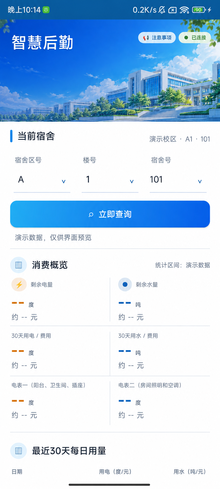

<p align="center">
  
</p>

<h1 align="center">福建理工大学智慧后勤</h1>

<p align="center">
  一款用于查询宿舍最近 30 天水电消耗、剩余量与费用估算的 Android 应用。
</p>

<p align="center">
  <a href="https://github.com/jmsgfc/FJUT-Intelligent-Logistics/releases/tag/v1.8.8"></a>
  
  
</p>

<p align="center">
  <a href="https://github.com/jmsgfc/FJUT-Intelligent-Logistics/releases/download/v1.8.8/SmartLogistics-v1.8.8-debug.apk"><strong>下载 APK</strong></a>
  ·
  <a href="https://github.com/jmsgfc/FJUT-Intelligent-Logistics/releases/tag/v1.8.8">查看发布说明</a>
</p>

> [!IMPORTANT]
> 本项目是个人开发的第三方查询工具，并非福建理工大学官方应用。查询结果和费用估算仅供参考，实际数据与收费金额以学校智慧后勤系统为准。

## 应用预览

<p align="center">
  
</p>

<p align="center"><sub>公开预览使用脱敏演示数据，实际查询结果以学校系统返回为准。</sub></p>

## 功能

| 功能 | 说明 |
| --- | --- |
| 登录与会话 | 通过手机号、短信验证码和学号完成绑定，启动时自动检查本地 Cookie |
| 宿舍查询 | 按宿舍区号、楼号和宿舍号选择或输入查询对象 |
| 剩余水电 | 展示宿舍剩余电量、剩余水量及对应金额估算 |
| 30 天汇总 | 汇总最近 30 天用电、用水与预计费用 |
| 每日明细 | 展示最近 30 天内返回的每日水电用量和金额 |
| 分表统计 | 分别展示电表一（阳台、卫生间、插座）和电表二（房间照明、空调）的用量 |
| 诊断日志 | 连续点击顶部“智慧后勤”6 次，可查看、清除或导出脱敏日志 |
| 查询保护 | 防重复提交、1 秒查询冷却、短时结果缓存及业务码 400 有界重试 |

## 计价标准

| 项目 | 单价 | 客户端展示 |
| --- | ---: | --- |
| 电费 | 0.5333 元/度 | 剩余金额、30 天费用、每日费用、分表费用 |
| 水费 | 2.6 元/吨 | 剩余金额、30 天费用、每日费用 |

费用由客户端根据查询到的用量计算，不代表学校最终账单。

## 技术实现

| 类别 | 实现 |
| --- | --- |
| 开发语言 | Java 17 |
| 界面 | Android 原生 View |
| 网络请求 | `HttpsURLConnection` |
| 本地加密 | Android Keystore + AES-GCM |
| 构建 | Gradle 8.11.1 + Android Gradle Plugin 8.10.1 |
| 最低版本 | Android 6.0（API 23） |
| 应用权限 | 仅申请 `INTERNET` 网络权限 |

## 关键实现细节

### 登录与数据安全

- 密码默认使用学号后 6 位，仅用于智慧后勤绑定请求，不保存密码和短信验证码。
- 登录 Cookie 和设备标识使用 Android Keystore 生成的 AES-GCM 密钥加密，保存在应用私有目录。
- 手机号和学号仅为方便下次填写而保存在应用私有偏好设置中，可通过清除登录状态删除。
- 应用备份和设备迁移显式排除本地登录数据。
- 诊断日志会隐藏手机号、学号、Cookie、密码、验证码、查询参数和设备标识。

### 网络边界

- 仅向预期的福建理工大学智慧后勤地址发送认证信息。
- 如果服务器把请求重定向到学校 VPN 导航页，应用会停止请求并提示网络限制。
- 当前版本不内置 WebVPN；校外使用需要学校允许的系统级 VPN，或等待学校将智慧后勤加入 WebVPN 资源列表。

## 下载与安装

前往 [Releases](https://github.com/jmsgfc/FJUT-Intelligent-Logistics/releases/tag/v1.8.8) 下载 APK，或直接点击：

**[SmartLogistics-v1.8.8-debug.apk](https://github.com/jmsgfc/FJUT-Intelligent-Logistics/releases/download/v1.8.8/SmartLogistics-v1.8.8-debug.apk)**

当前发布包使用 Android Debug 证书签名，仅供个人测试与交流使用。正式长期分发应改用独立的 Release 签名。

连接已启用 USB 调试的 Android 手机后，也可以使用 ADB 安装：

```powershell
adb install -r SmartLogistics-v1.8.8-debug.apk
```

## 本地编译

### 环境要求

| 工具 | 版本 |
| --- | --- |
| JDK | 17 |
| Android SDK | Compile SDK 36 |
| Gradle | Wrapper 已包含，无需单独安装 |

Windows：

```powershell
gradlew.bat assembleDebug
```

macOS / Linux：

```bash
./gradlew assembleDebug
```

生成文件：

```text
app/build/outputs/apk/debug/app-debug.apk
```

## 项目结构

```text
app/src/main/java/com/local/smartlogistics/
├── MainActivity.java            # 主界面、登录和交互逻辑
├── SmartLogisticsClient.java    # 智慧后勤网络请求与数据解析
├── SecureStore.java             # Android Keystore 加密存储
├── DiagnosticLog.java           # 脱敏诊断日志
└── UsageSummary.java            # 水电统计数据模型
```

## 当前版本

| 项目 | 值 |
| --- | --- |
| 应用版本 | `1.8.8` |
| versionCode | `27` |
| 包名 | `com.local.smartlogistics` |
| 最低 Android 版本 | Android 6.0 |

## 使用提醒

- 请勿将短信验证码、密码、Cookie 或导出的诊断日志公开上传。
- 请合理控制查询频率，避免连续频繁请求学校服务器。
- 学校接口、页面结构或计费规则发生变化时，应用可能需要同步更新。
